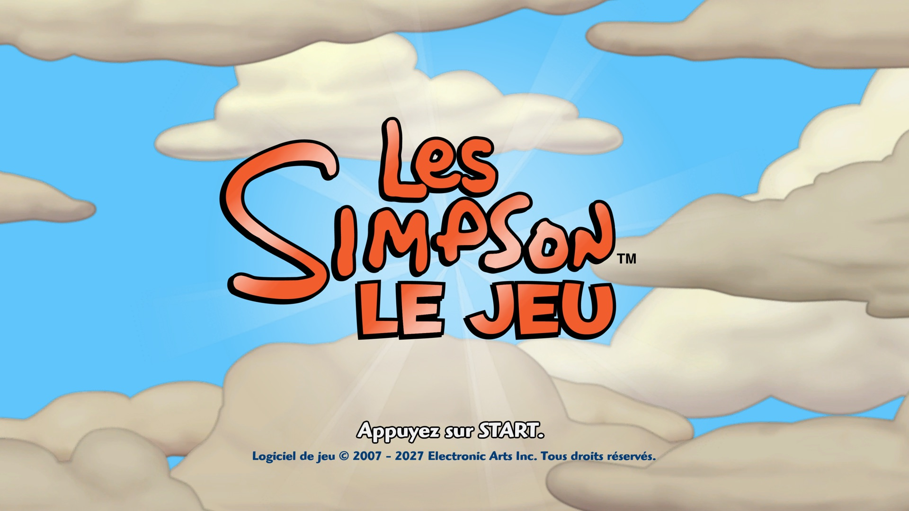
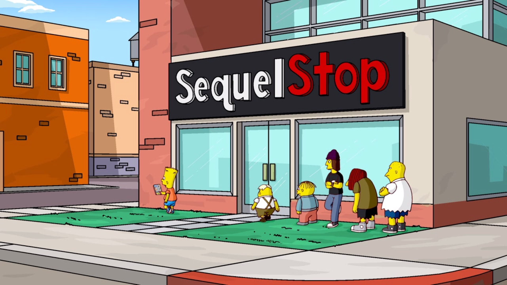
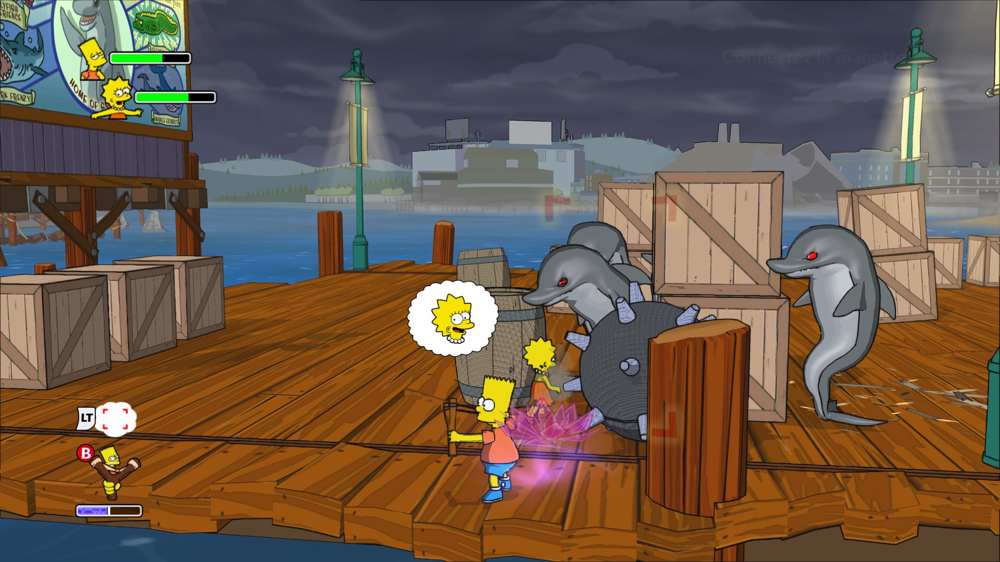
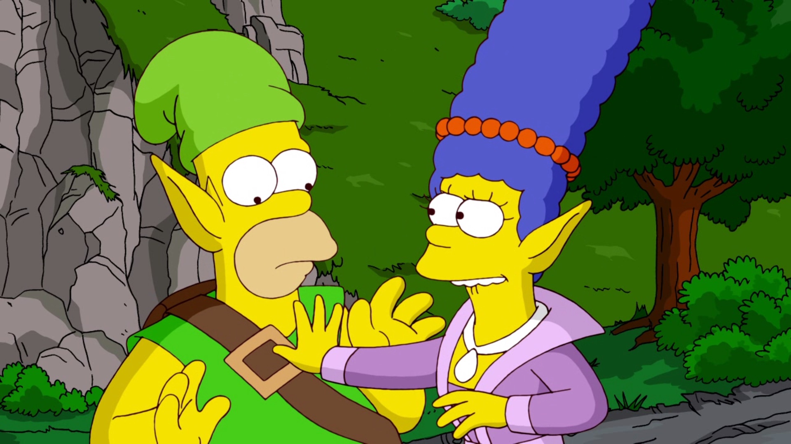
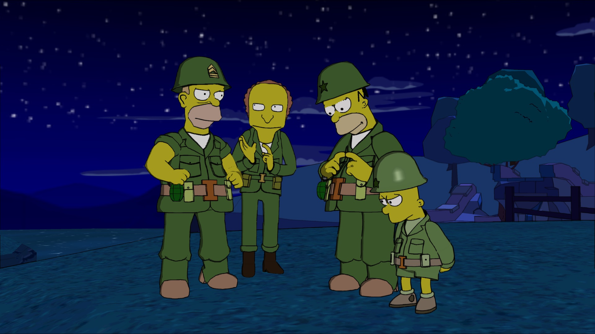

# Les Simpson : le jeu — recompilation

Portage natif de *The Simpsons Game* (Xbox 360, EA, 2007) par recompilation statique : le code PowerPC du jeu est
traduit en C++ par [XenonRecomp](https://github.com/hedge-dev/XenonRecomp), puis compilé pour la machine. Le
runtime de ce dépôt imite ce dont le jeu a besoin sur la console : noyau, threads, fichiers, son XMA, manettes et
processeur graphique Xenos (rendu Vulkan, traduction des shaders pendant la partie avec
[XenosRecomp](https://github.com/hedge-dev/XenosRecomp) et DXC).

**Ce dépôt ne contient aucune donnée du jeu.** Il faut sa propre copie du disque Xbox 360. La version testée est la
version française (PAL) ; le code est identique en NTSC-U et en PAL italien/espagnol.

<p align="center">
  
  
  
  
  
  
  
</p>
<p align="center"><em>Captures sur Mac en résolution 4K interne (réduites ici en 1920×1080).</em></p>

## Plateformes

| Plateforme | État | Construction |
|---|---|---|
| Mac à puce Apple (macOS 15+) | jouable, 60 images/s jusqu'en 5K | `portable/construire_dependances_mac.sh` puis `tools/creer_application.sh` |
| Apple TV 4K (tvOS 17+, testé sur la 3e génération) | jouable en 720p, 60 images/s | `tvos/construire_dependances_tvos.sh` puis `tvos/creer_application_tvos.sh` |
| Windows 10/11 x64 | compilé depuis le Mac ou Linux, peu testé | `windows/creer_dossier_windows.sh` |
| Linux x64 | jouable | `linux/construire.sh` (sur le PC Linux) |

## Jouer

- **Manette** : une manette Xbox (filaire ou Bluetooth) ou compatible XInput fonctionne directement.
- **Clavier** : flèches ou ZQSD pour se déplacer, Entrée = START, Espace = A, E = B, R = X, F = Y.
- **Plein écran** : le jeu démarre en plein écran ; Cmd+F (Mac), Alt+Entrée ou F11 pour passer en fenêtre.
- **Apple TV** : maintenir B pendant 2 secondes pour revenir à l'écran d'accueil.
- Le jeu tourne à 60 images/s (`SIMPSONS_30IPS=1` pour revenir aux 30 images/s d'origine).

| Plateforme | Sauvegardes et journal (`jeu.log`) |
|---|---|
| Mac | `~/Library/Application Support/Les Simpson - Le Jeu` |
| Apple TV | `Library/Caches/Les Simpson - Le Jeu` (dans l'application) |
| Windows | `%LOCALAPPDATA%\Les Simpson - Le Jeu` |
| Linux | `~/.local/share/les-simpson-le-jeu` |

## Améliorations par rapport à la console

- **Démarrage plus rapide** : les vidéos des logos EA, Fox et Gracie Films sont passées et l'écran des mentions
  légales Fox est retiré (`tools/retirer_fox.py`) : l'écran « Appuyez sur START » arrive en 8 s environ au lieu de
  24 s. `SIMPSONS_LOGOS=1` remet les vidéos.
- **Lissage des textures** : le jeu ne donne qu'un seul niveau de détail à certaines images affichées bien plus
  petites que leur taille réelle (le logo de l'écran titre, 2048×1024, s'affiche sur environ 600 pixels), d'où des
  bords crénelés. Le runtime leur fabrique des versions réduites (mipmaps) : logo du titre et police des textes
  nettement plus lisses. La liste est dans `simpsons/modifications/textures/*.mips`.
- **Logo « EA | 5K ULTRA HD »** à la place de « EA | HD » sur l'écran de démarrage (`tools/logo_4k.py`).
- **Textes adaptés à l'ordinateur** : les mentions de la console Xbox 360 et du Xbox LIVE disparaissent (« Ne pas
  éteindre la console Xbox 360 » devient « Ne pas quitter le jeu », « sur votre console Xbox 360 » devient « sur
  votre ordinateur »…), et l'écran de démarrage annonce « 5K ULTRA HD » au lieu de « COMPATIBLE HD »
  (`simpsons/modifications/textes_fr.tsv`, appliqué par `tools/modifier_textes.py`).
- **60 images/s** au lieu de 30, et résolution interne jusqu'en 5K.

## Préparer le projet

Outils (Mac) : Xcode, `brew install cmake ninja python autoconf automake libtool pkg-config molten-vk xcodegen`.

1. **Recompilateurs**, à côté de `simpsons/`, avec les correctifs de `correctifs/` :
   ```sh
   git clone https://github.com/hedge-dev/XenonRecomp.git && git -C XenonRecomp checkout ddd128b
   git -C XenonRecomp submodule update --init --recursive && git -C XenonRecomp apply ../correctifs/XenonRecomp.patch
   git clone https://github.com/hedge-dev/XenosRecomp.git && git -C XenosRecomp checkout 990d03b
   git -C XenosRecomp submodule update --init --recursive && git -C XenosRecomp apply ../correctifs/XenosRecomp.patch
   ```
2. **Données du jeu** : extraire l'ISO dans `simpsons/game/` avec
   [extract-xiso](https://github.com/XboxDev/extract-xiso) (`extract-xiso -d simpsons/game <jeu.iso>`).
3. **Recompiler le code du jeu** (produit `simpsons/ppc/`, jamais publié) :
   ```sh
   cmake -S XenonRecomp -B XenonRecomp/build -G Ninja -DCMAKE_BUILD_TYPE=Release "-DCMAKE_CXX_FLAGS=-include cstdlib"
   ninja -C XenonRecomp/build XenonRecomp
   cd simpsons/recomp && ../../XenonRecomp/build/XenonRecomp/XenonRecomp simpsons.toml ../../XenonRecomp/XenonUtils/ppc_context.h
   ```
   `simpsons_opt.toml` donne une variante plus rapide (`simpsons/ppc-opt`, option CMake `SIMPSONS_PPC_DIR=ppc-opt`).

## Mac

```sh
zsh portable/construire_dependances_mac.sh   # SDL3, libusb, FFmpeg statiques ; configure simpsons/build-portable
zsh tools/creer_application.sh               # compile et installe /Applications/Jeux/Les Simpson - Le Jeu.app
```
L'application est autonome (seule la bibliothèque DXC est livrée à côté du programme). Les données du disque sont
déplacées dans l'application ; sauvegardes et journal (`jeu.log`) dans
`~/Library/Application Support/Les Simpson - Le Jeu`. Optimisation par profil d'exécution : `tools/entrainer_pgo.sh`.

## Apple TV

Il faut un compte développeur Apple et l'Apple TV appairée avec Xcode (Réglages > Télécommandes et appareils >
Télécommande d'app et appareils).

```sh
cp tvos/config.exemple tvos/config.local     # puis le remplir : équipe, identifiant, Apple TV, certificat
zsh tvos/construire_dependances_tvos.sh      # SDL3, FFmpeg, MoltenVK et DXC pour tvOS (environ 30 min)
zsh tools/creer_application.sh               # une fois : l'application Mac fournit les données du jeu
zsh tvos/creer_application_tvos.sh           # compile, signe et installe sur l'Apple TV
```
Particularités de tvOS gérées par le runtime (`SIMPSONS_TVOS`) : environ 2 Go de mémoire par application (caches
réduits), pas de compression de textures BC sur la puce A15 (textures décompressées par le processeur), système de
fichiers sensible à la casse, seul `Library/Caches` est inscriptible (sauvegardes et journal, que tvOS peut vider
si la place manque), pas de `shm_open` (mémoire physique reprojetée avec `vm_remap`). DXC est recompilé pour tvOS
avec `correctifs/dxc-tvos.patch`. L'icône se fabrique avec `tvos/icone/fabriquer_images.swift` à partir d'une
capture 4K de l'écran titre (`SIMPSONS_RESOLUTION=3 SIMPSONS_CAPTURE=900`). `tvos/sonde` mesure ce que l'Apple TV
autorise (mémoire, espace d'adresses, dossiers).

## Windows

Compilation croisée depuis le Mac ou Linux avec [llvm-mingw](https://github.com/mingw-w64/llvm-mingw) (version
20261006, à décompresser dans `windows/outils/`) et les fichiers CMake `windows/mingw-x64.cmake` (Mac) ou
`windows/mingw-x64-linux.cmake` (Linux) ; SDL3 et FFmpeg compilés pour Windows vont dans `windows/prefix`. Une fois
`windows/build` configuré, `zsh windows/creer_dossier_windows.sh` compile et prépare
`windows/Les Simpson - Le Jeu (Windows)/` (programme, DLL de DXC, données du jeu reprises de l'application Mac,
`LISEZMOI.txt`), à copier sur le PC.

## Linux

Sur le PC Linux (x64), dans une copie du dossier du projet qui contient déjà `XenonRecomp`, `XenosRecomp`,
`simpsons/ppc` et les sources de `portable/src` (SDL3 et FFmpeg, récupérées par
`portable/construire_dependances_mac.sh`) :
```sh
bash linux/construire.sh
```
Le script installe les paquets nécessaires (apt, dnf ou pacman), compile SDL3, FFmpeg et le jeu, puis installe le
jeu dans `~/Jeux/Les Simpson - Le Jeu` avec un raccourci dans le menu des applications. Il faut un Linux de 2022 ou
plus récent (glibc 2.35), un processeur x86-64-v3 (Intel Haswell, AMD Ryzen) et un pilote Vulkan.

## Réglages (variables d'environnement)

| Variable | Effet |
|---|---|
| `SIMPSONS_RESOLUTION=1..4` | résolution interne (720p, 1440p, 4K, 5K) |
| `SIMPSONS_30IPS=1` | 30 images/s comme sur la console |
| `SIMPSONS_LOGOS=1` | vidéos des logos au démarrage |
| `SIMPSONS_FENETRE=1` | fenêtre au lieu du plein écran (Mac) |
| `SIMPSONS_CONSOLE=1` | journal sur la sortie d'erreur au lieu de `jeu.log` |
| `SIMPSONS_CAPTURE=<images>` | captures d'écran (`recomp/capture_N.ppm`) |
| `SIMPSONS_MEMOIRE_REDUITE=1` | caches réduits comme sur l'Apple TV |
| `SIMPSONS_SANS_BC=1` | textures BC décompressées par le processeur comme sur l'Apple TV |
| `SIMPSONS_TRACE_AUDIO=1` | détails du son (contextes et décodeurs XMA) |

`tools/test_episode.sh <EPISODE> [secondes]` lance une nouvelle partie à un épisode donné (par exemple
`LAND_OF_CHOCOLATE`) avec des touches simulées, et prend des captures.

## Organisation

- `simpsons/runtime/` : runtime (chargeur, noyau, threads, fichiers, son, manettes, GPU et rendu Vulkan)
- `simpsons/lib/` : construction du code recompilé ; `simpsons/recomp/*.toml` : configuration de XenonRecomp
- `simpsons/modifications/` : textes adaptés à l'ordinateur et images remplacées (faites par `tools/`)
- `tools/` : scripts d'analyse, de modification des fichiers du jeu, de test et de construction de l'application Mac
- `portable/`, `tvos/`, `windows/`, `linux/` : construction pour chaque plateforme
- `correctifs/` : modifications de XenonRecomp, XenosRecomp et DXC

The Simpsons Game © Electronic Arts. Les Simpson © 20th Century Studios. Projet non officiel, sans lien avec eux.
