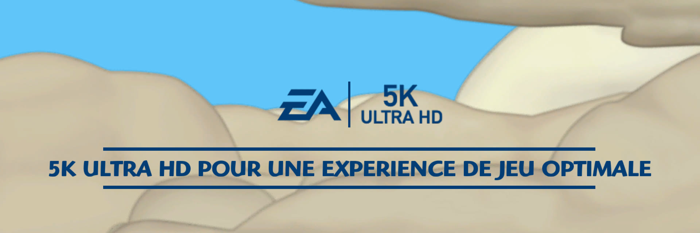

# The Simpsons Game — recompilation

*[Version française](README.fr.md)*

A native port of *The Simpsons Game* (Xbox 360, EA, 2007) made by static recompilation: the game's PowerPC code is
translated to C++ by [XenonRecomp](https://github.com/hedge-dev/XenonRecomp), then compiled for the target machine.
The runtime in this repository provides what the game expects from the console: kernel, threads, files, XMA audio,
controllers and the Xenos GPU (Vulkan renderer, shaders translated at run time with
[XenosRecomp](https://github.com/hedge-dev/XenosRecomp) and DXC).

**This repository contains no game data.** You need your own copy of the Xbox 360 disc. The tested version is the
French (PAL) release; the code is identical in the NTSC-U and the Italian/Spanish PAL releases.

<p align="center">
  
  
  
  
  
  
  
</p>
<p align="center"><em>Captured on a Mac at 4K internal resolution (scaled down to 1920×1080 here).</em></p>

## Platforms

| Platform | Status | Build |
|---|---|---|
| Apple silicon Mac (macOS 15+) | playable, 60 fps, 1440p to 5K depending on the chip (see below) | `portable/construire_dependances_mac.sh` then `tools/creer_application.sh` |
| Apple TV 4K (tvOS 17+, tested on the 3rd generation) | playable at 720p, 60 fps | `tvos/construire_dependances_tvos.sh` then `tvos/creer_application_tvos.sh` |
| Windows 10/11 x64 | cross-compiled from the Mac or Linux, lightly tested | `windows/creer_dossier_windows.sh` |
| Linux x64 | playable | `linux/construire.sh` (on the Linux PC) |

Not every machine can hold 60 fps at 5K, so the game picks its internal resolution from the GPU.

| Machine | Default resolution |
|---|---|
| Mac with a Max or Ultra chip (30 GPU cores or more) | 5K (5120×2880), 60 fps tested on M2 Max |
| Mac with a Pro chip (14 to 29 cores) | 4K (3840×2160) |
| Mac with a base chip, MacBook Air (fewer than 14 cores) | 1440p (2560×1440), not measured yet: 60 fps may drop in busy scenes |
| PC with a dedicated GPU, 12 GB or more | 5K |
| PC with a dedicated GPU, 8 to 11 GB | 4K |
| PC with a dedicated GPU, less than 8 GB | 1440p |
| PC without a dedicated GPU (Intel or AMD integrated graphics) | 720p |
| Apple TV | 720p |

The dedicated GPU thresholds have not been checked on real hardware yet. The choice is written to `jeu.log`
(`puce graphique : … resolution xN`). `SIMPSONS_RESOLUTION` (see [Settings](#settings-environment-variables))
forces another resolution; if the game stutters, go one step lower.

## Playing

- **Controller**: an Xbox controller (wired or Bluetooth) or any XInput-compatible controller works out of the box.
- **Keyboard**: arrow keys or WASD (ZQSD on AZERTY) to move, Enter = START, Space = A, E = B, R = X, F = Y.
- **Fullscreen**: the game starts fullscreen; Cmd+F (Mac), Alt+Enter or F11 to switch to a window.
- **Apple TV**: hold B for 2 seconds to return to the home screen.
- Levels run at 60 fps (`SIMPSONS_30IPS=1` restores the original 30 fps), with Havok physics stepping every frame
  (1/60 s steps). Menus, the title screen and loading screens stay at 30 fps, as they were made for: their logic
  counts frames.

| Platform | Saves and log (`jeu.log`) |
|---|---|
| Mac | `~/Library/Application Support/Les Simpson - Le Jeu` |
| Apple TV | `Library/Caches/Les Simpson - Le Jeu` (inside the app) |
| Windows | `%LOCALAPPDATA%\Les Simpson - Le Jeu` |
| Linux | `~/.local/share/les-simpson-le-jeu` |

## Improvements over the console

- **Faster startup**: the EA, Fox and Gracie Films logo movies are skipped and the Fox legal screen is removed
  (`tools/retirer_fox.py`): the "Press START" screen appears after about 8 s instead of 24 s. `SIMPSONS_LOGOS=1`
  brings the movies back.
- **Smoother textures**: the game provides a single level of detail for some images that are drawn much smaller than
  their real size (the title screen logo, 2048×1024, covers about 600 pixels), which gives jagged edges. The runtime
  builds downscaled versions (mipmaps) for them: the title logo and the text font are much smoother. The list is in
  `simpsons/modifications/textures/*.mips`.
- **"EA | 5K ULTRA HD" logo** instead of "EA | HD" on the startup screen (image not included in the repository: `python3 tools/logo_4k.py` makes it, on a Mac).
- **Text adapted to a computer**: mentions of the Xbox 360 console and Xbox LIVE are gone ("Do not turn off the Xbox
  360 console" becomes "Do not quit the game", "on your Xbox 360 console" becomes "on your computer"…), and the
  startup screen says "5K ULTRA HD" instead of "HD COMPATIBLE" (`simpsons/modifications/textes_fr.tsv`, applied by
  `tools/modifier_textes.py`; French text only for now).
- **60 fps** instead of 30, and internal resolution up to 5K on the most powerful Macs.

<p align="center">
  
</p>
<p align="center"><em>The redrawn startup logo at full resolution (crop of a 4K capture).</em></p>

## Setting up the project

Tools (Mac): Xcode, `brew install cmake ninja python autoconf automake libtool pkg-config molten-vk xcodegen`.

1. **Recompilers**, next to `simpsons/`, with the patches from `correctifs/`:
   ```sh
   git clone https://github.com/hedge-dev/XenonRecomp.git && git -C XenonRecomp checkout ddd128b
   git -C XenonRecomp submodule update --init --recursive && git -C XenonRecomp apply ../correctifs/XenonRecomp.patch
   git clone https://github.com/hedge-dev/XenosRecomp.git && git -C XenosRecomp checkout 990d03b
   git -C XenosRecomp submodule update --init --recursive && git -C XenosRecomp apply ../correctifs/XenosRecomp.patch
   ```
2. **Game data**: extract the ISO into `simpsons/game/` with
   [extract-xiso](https://github.com/XboxDev/extract-xiso) (`extract-xiso -d simpsons/game <game.iso>`).
3. **Recompile the game code** (produces `simpsons/ppc/`, never published):
   ```sh
   cmake -S XenonRecomp -B XenonRecomp/build -G Ninja -DCMAKE_BUILD_TYPE=Release "-DCMAKE_CXX_FLAGS=-include cstdlib"
   ninja -C XenonRecomp/build XenonRecomp
   cd simpsons/recomp && ../../XenonRecomp/build/XenonRecomp/XenonRecomp simpsons.toml ../../XenonRecomp/XenonUtils/ppc_context.h
   ```
   `simpsons_opt.toml` gives a faster variant (`simpsons/ppc-opt`, CMake option `SIMPSONS_PPC_DIR=ppc-opt`).

## Mac

```sh
zsh portable/construire_dependances_mac.sh   # static SDL3, libusb, FFmpeg; configures simpsons/build-portable
zsh tools/creer_application.sh               # builds and installs /Applications/Jeux/Les Simpson - Le Jeu.app
```
The app is self-contained (only the DXC library ships next to the executable). The disc data is moved into the app;
saves and log (`jeu.log`) go to `~/Library/Application Support/Les Simpson - Le Jeu`. Profile-guided optimization:
`tools/entrainer_pgo.sh`.

## Apple TV

You need an Apple developer account and the Apple TV paired with Xcode (Settings > Remotes and Devices > Remote App
and Devices).

```sh
cp tvos/config.exemple tvos/config.local     # then fill it in: team, bundle identifier, Apple TV, certificate
zsh tvos/construire_dependances_tvos.sh      # SDL3, FFmpeg, MoltenVK and DXC for tvOS (about 30 min)
zsh tools/creer_application.sh               # once: the Mac app provides the game data
zsh tvos/creer_application_tvos.sh           # builds, signs and installs on the Apple TV
```
tvOS specifics handled by the runtime (`SIMPSONS_TVOS`): about 2 GB of memory per app (smaller caches), no BC texture
compression on the A15 chip (textures decompressed on the CPU), case-sensitive file system, only `Library/Caches` is
writable (saves and log, which tvOS may purge when space runs low), no `shm_open` (physical memory remapped with
`vm_remap`). DXC is rebuilt for tvOS with `correctifs/dxc-tvos.patch`. The icon is made with
`tvos/icone/fabriquer_images.swift` from a 4K capture of the title screen
(`SIMPSONS_RESOLUTION=3 SIMPSONS_CAPTURE=900`). `tvos/sonde` measures what the Apple TV allows (memory, address
space, folders).

## Windows

Cross-compiled from the Mac or Linux with [llvm-mingw](https://github.com/mingw-w64/llvm-mingw) (release 20261006,
unpacked into `windows/outils/`) and the CMake toolchain files `windows/mingw-x64.cmake` (Mac) or
`windows/mingw-x64-linux.cmake` (Linux); SDL3 and FFmpeg built for Windows go into `windows/prefix`. Once
`windows/build` is configured, `zsh windows/creer_dossier_windows.sh` builds and prepares
`windows/Les Simpson - Le Jeu (Windows)/` (executable, DXC DLL, game data taken from the Mac app, `LISEZMOI.txt`),
to be copied to the PC.

## Linux

On the Linux PC (x64), in a copy of the project folder that already contains `XenonRecomp`, `XenosRecomp`,
`simpsons/ppc` and the sources in `portable/src` (SDL3 and FFmpeg, fetched by
`portable/construire_dependances_mac.sh`):
```sh
bash linux/construire.sh
```
The script installs the required packages (apt, dnf or pacman), builds SDL3, FFmpeg and the game, then installs the
game into `~/Jeux/Les Simpson - Le Jeu` with a shortcut in the applications menu. It needs a 2022 or newer Linux
(glibc 2.35), an x86-64-v3 CPU (Intel Haswell, AMD Ryzen) and a Vulkan driver.

## Settings (environment variables)

| Variable | Effect |
|---|---|
| `SIMPSONS_RESOLUTION=1..4` | internal resolution (720p, 1440p, 4K, 5K) |
| `SIMPSONS_FXAA=0` | no FXAA anti-aliasing at presentation (on by default) |
| `SIMPSONS_30IPS=1` | 30 fps like the console |
| `SIMPSONS_MENUS_60=1` | menus and title screen at 60 fps too (they then run twice as fast) |
| `SIMPSONS_PHYSIQUE_ORIGINALE=1` | Havok physics as shipped (30 steps per second at 60 fps) |
| `SIMPSONS_TRACE_PHYSIQUE=1` | physics steps per frame every 5 s |
| `SIMPSONS_LOGOS=1` | logo movies at startup |
| `SIMPSONS_FENETRE=1` | window instead of fullscreen (Mac) |
| `SIMPSONS_CONSOLE=1` | log to standard error instead of `jeu.log` |
| `SIMPSONS_CAPTURE=<frames>` | screenshots (`recomp/capture_N.ppm`) |
| `SIMPSONS_MEMOIRE_REDUITE=1` | smaller caches like on the Apple TV |
| `SIMPSONS_SANS_BC=1` | BC textures decompressed on the CPU like on the Apple TV |
| `SIMPSONS_TRACE_AUDIO=1` | audio details (XMA contexts and decoders) |

`tools/test_episode.sh <EPISODE> [seconds]` starts a new game at a given episode (for example `LAND_OF_CHOCOLATE`)
with simulated key presses, and takes screenshots.

## Layout

- `simpsons/runtime/`: runtime (loader, kernel, threads, files, audio, controllers, GPU and Vulkan renderer)
- `simpsons/lib/`: build of the recompiled code; `simpsons/recomp/*.toml`: XenonRecomp configuration
- `simpsons/modifications/`: text adapted to a computer and replaced images (made by `tools/`)
- `tools/`: scripts for analysis, game file edits, testing and building the Mac app
- `portable/`, `tvos/`, `windows/`, `linux/`: per-platform builds
- `correctifs/`: patches for XenonRecomp, XenosRecomp and DXC

## License

The code of this project is under the GNU General Public License v3.0 (see [LICENSE](LICENSE)). It covers neither
the game nor its data: you need your own copy of the disc.

The Simpsons Game © Electronic Arts. The Simpsons © 20th Century Studios. Unofficial project, not affiliated with
them.
